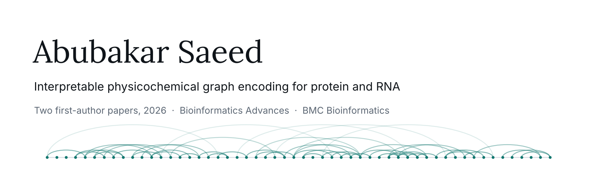

<picture>
  <source media="(prefers-color-scheme: dark)" srcset="assets/banner-dark.png">
  
</picture>

I build **sequence-only encodings of biological molecules** that stay
interpretable: a residue or nucleotide is described by the interactions it
could form with its neighbours, as a deterministic graph, with no predicted
structure anywhere in the pipeline. The same encoding now covers four
biological tasks, and every feature in it traces back to a published
biophysical rule.

BS Computer Science (2026), GC University Faisalabad · CGPA 3.81/4.0 ·
pre-medical background · independent researcher since 2025.

---

## Publications

**BioGraphX: Bridging the Sequence–Structure Gap via Physicochemical Graph
Encoding for Interpretable Subcellular Localization Prediction**
Saeed A., Abbas W. · *Bioinformatics Advances* (Oxford University Press), 2026
[`10.1093/bioadv/vbag181`](https://doi.org/10.1093/bioadv/vbag181)

**BioGraphX-RNA: A Universal Physicochemical Graph Encoding for Interpretable
RNA Subcellular Localization Prediction**
Saeed A., Abbas W. · *BMC Bioinformatics*, 2026
[`10.1186/s12859-026-06619-5`](https://doi.org/10.1186/s12859-026-06619-5)

### Under review

**BioGraphX-IDP** — intrinsic disorder prediction · *Bioinformatics* (Oxford)
61 biophysical features gated per residue against frozen ESM-2. Blind CAID-3
evaluation: AUC 0.899 (PDB), 0.886 (NOX).

**BioGraphX-Sol** — protein solubility · *BMC Bioinformatics*
A physics-only model (R² = 0.499) exceeds FGNNSol, which builds on AlphaFold3
structures (R² = 0.487). The ensemble matches ProtSATT at R² = 0.545 with
1.44M parameters against 6M.

---

## The framework

| Domain | What it encodes | Result that matters |
|---|---|---|
| Protein localisation | Residue interaction graph, 158 features | State of the art on DeepLoc 2.0 |
| RNA localisation | Base pairing, stacking, stem-loops, pseudoknots | Graph-only miRNA AUROC 0.9396, 2.05M parameters |
| Intrinsic disorder | Per-residue gating against ESM-2 | Blind CAID-3: 0.899 PDB / 0.886 NOX |
| Solubility | 200-dimensional physicochemical encoding | Beats a structure-based model without using structures |

**One finding ties them together.** Each paper measures how much of the signal
is biophysics and how much is evolutionary information, by sweeping the blend
weight. The answer depends on how the property is defined, not on the
molecule: solubility, a physically measured property, lands at 59% physics;
disorder lands at 49% on the structurally observed CAID-3 PDB track but 13% on
the functionally annotated NOX track — a 3.8-fold difference between two tracks
of the same task.

**What the encoding is.** A residue or nucleotide is described by the
interactions it *could* form given its sequence neighbourhood — interaction
capacity rather than geometry. That is complementary to a contact map, not an
approximation of one, which is why the method needs no predicted structure, no
multiple sequence alignment, and no solved structure for the target, and why
every feature stays readable back to the rule that produced it.

## Interests

Interpretable AI for biomedicine · protein and RNA structure–function
prediction · graph representations of sequence · parameter-efficient and Green
AI · generative models for RNA and protein design · bioinformatics tool
development

## Tools

Python · PyTorch · XGBoost · SHAP · ESM-2 · RiNALMo · BioPython · igraph ·
LaTeX · Java, C++, JavaScript, SQL

---

[Email](mailto:abubakarsaeedgcuf@gmail.com) ·
[LinkedIn](https://linkedin.com/in/abubakarsaeed915) ·
Chiniot, Punjab, Pakistan
